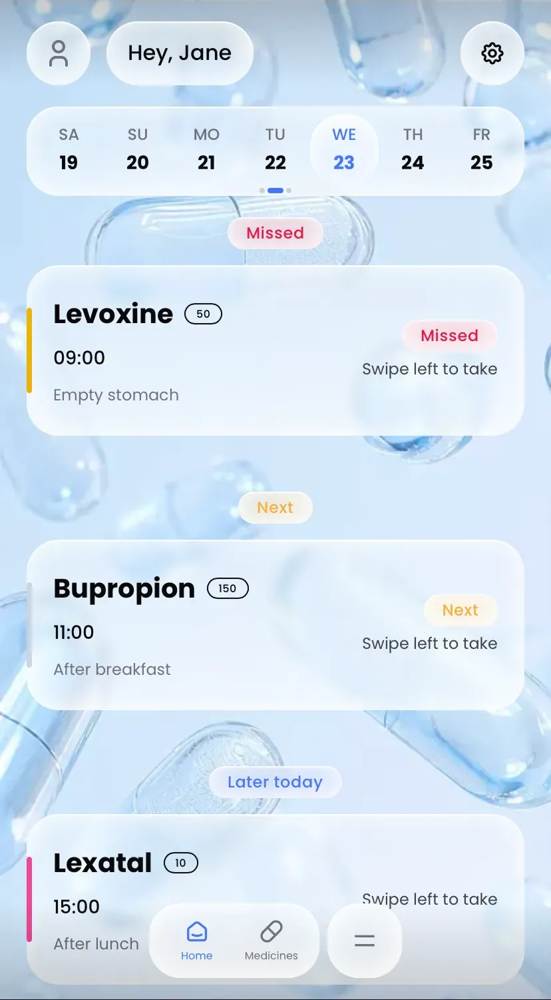
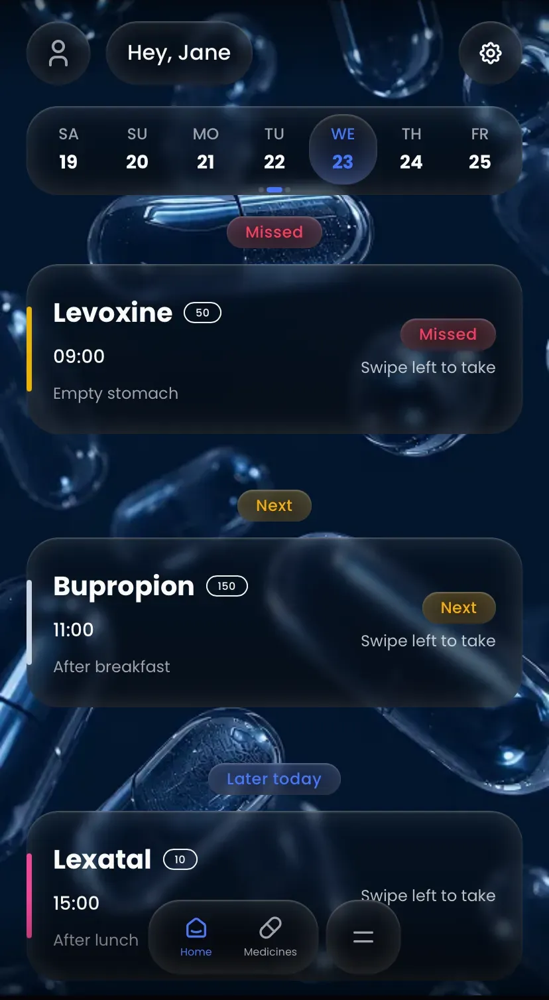

<div align="center">

# Meds Reminder (یادآور دارو)

**A beautiful, gesture-driven Progressive Web App (PWA) for tracking daily medications.**
Fully bilingual (English/Persian) with native RTL support, Shamsi/Gregorian calendars, and offline capabilities.

[](https://react.dev/)
[](https://www.typescriptlang.org/)
[](https://tailwindcss.com/)
[](https://vitejs.dev/)
[](https://web.dev/progressive-web-apps/)

</div>

---

<div align="center">
  
  &nbsp;&nbsp;&nbsp;&nbsp;
  
</div>

---

## Key Features

- **Smart Medication Tracking:** Swipe left/right to take or undo doses. Visual history categorizes doses into Missed, Next, Upcoming, and Taken.
- **Advanced Calendar Carousel:** Swipeable weekly calendar with pagination dots. Auto-advances at midnight, even if the app is in a background tab.
- **Fully Bilingual (EN/FA):** Seamless LTR/RTL switching. Uses the **Shamsi (Jalali)** calendar with Persian digits for Farsi, and **Gregorian** for English.
- **Glassmorphic UI:** Custom design system built with Tailwind CSS v4, featuring frosted glass effects, smooth skeleton loaders, and a stacked toast notification system.
- **Native Gestures:** Buttery smooth swipe-to-dismiss, rubber-band edge resistance, and pinch-to-zoom image cropping powered by `@use-gesture` and `framer-motion`.
- **Zero-Flash Theme & RTL:** Inline blocking scripts ensure Dark/Light mode and RTL/LTR directions are applied *before* the first browser paint.
- **Data Management:** Full Backup/Restore (JSON export/import handling Blobs via base64) and Factory Reset functionality.
- **Installable PWA:** Add to home screen on iOS and Android, works offline, and prompts for native installation.

---

## Tech Stack

| Category | Technologies |
| :--- | :--- |
| **Core** | React 19, Vite, TypeScript |
| **Styling & Animation** | Tailwind CSS v4, Framer Motion |
| **State Management** | Zustand (with `persist` middleware) |
| **Database** | Dexie.js (IndexedDB wrapper) |
| **Forms & Validation** | React Hook Form, Zod |
| **i18n & Dates** | i18next, date-fns, date-fns-jalali, `Intl` API |
| **Gestures** | `@use-gesture/react` |

---

## Getting Started

### Prerequisites
- Node.js (v18 or higher)
- npm or yarn or pnpm

### Installation

1. **Clone the repository:**
   ```bash
   git clone https://github.com/your-username/meds-reminder-pwa.git
   cd meds-reminder-pwa
   ```

2. **Install dependencies:**
   ```bash
   npm install
   ```

3. **Set up Environment Variables:**
   Create a `.env` file in the root directory:
   ```env
   VITE_APP_VERSION=1.0.0
   ```

4. **Run the development server:**
   ```bash
   npm run dev
   ```

5. **Build for production:**
   ```bash
   npm run build
   ```

---

## Project Structure

```text
src/
├── components/         # Reusable UI components (Button, Dialog, Typography, ImageCropper)
│   ├── layout/         # AppLayout, Sidebar, Header, BottomBar
│   └── medicines/      # MedicineCard, Add/Edit Modals
├── contexts/           # React Contexts (HeaderProvider)
├── db/                 # Dexie.js IndexedDB schema and types
├── hooks/              # Custom hooks (useIsRTL, useHeader, useInstallPrompt)
├── lib/                # Utilities, schemas (Zod), backup/restore logic, i18n config
├── locales/            # JSON translation files (en, fa)
├── providers/          # ThemeProvider, LanguageProvider
├── router/             # React Router setup and protected routes
├── screens/            # Main views (HomeScreen, MedicinesScreen, Profile, Settings, Wizard)
│   └── HomeScreen/     # Calendar, Schedule logic, DoseItems
└── stores/             # Zustand stores (Profile, Medicines, Logs, Settings, Toasts)
```

---

## License

This project is licensed under the MIT License - see the [LICENSE](LICENSE) file for details.

---

<div align="center">
  <sub>Built with React 19</sub>
</div>